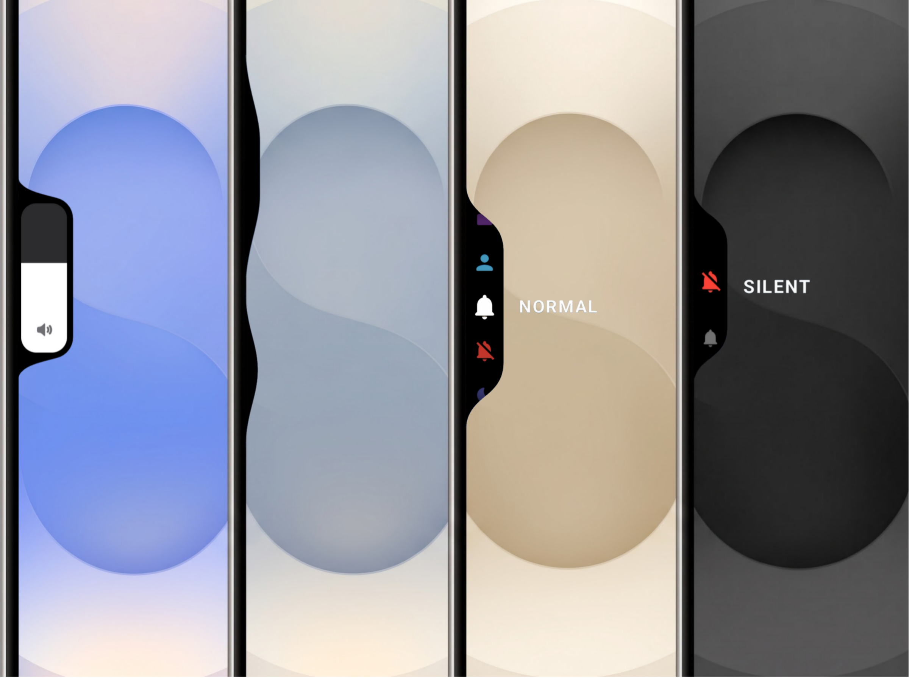

# Nudge Edge

The app shows edge pops as you volume or power buttons, redesigned volume slider, actions & modes panels and edge handles. Its Based on a concept design that has now become a reality.

  

## Features

- **Edge pops:** on volume and power button presses.
**Choose between two options:** Rounded-top or Flat-top with an optional white glow
  
- **Custom volume slider:** inspired by a concept design that was originally made for Iphones has now become a reality for Androids...
- **Thin volume slider:** when long pressing volume up/down or clicking them +2 times, it now shows a thin slider and its **OPTIONAL**
- **Cycle between Ring, Vibrate, and Mute modes easily:** Long pressing the sound icon on the slider HUD cycles between these 3 modes and displays a label for the current mode
- **Transparency & Blur for volume slider**

- **Audio Mixer:** attach it to the volume slider or leave it floating.
  
- **DND/Silent panel:** change between two modes either ring/silent or dnd on/off.
- **Modes/Actions panel:** add new custom modes with custom icons/colors/names or even edit the existing ones and change their order like how you want it to be! **How it works:** it sends a quick silent notification that can be used by different automation/routine apps to do the functionality you want. or even better, for automation apps specifically that can receive broadcasts, the app sends a broadcast when a mode is selected alongside the silent notification (there's a guide in the app for detailed info)
  
- **Both panels are triggered using side buttons** with up to 7 different combinations (custom buttons included for devices that has an additional button). When the panels are open, you can switch between modes using volume buttons or gesture swiping!

- **Nudge Edge handles:** open by swiping: Run actions like screenshots, flashlight, camera, and more.
**Up to 10 nudges.**
**Many actions to choose from including:**
**Nudge Menu:** a customizable menu that has all nudge options in a single place by cycling between them
**Open Apps Menu:** choose your favourite apps, re-order them as you like, and cycle between them

- **Individual app volume is here!** show it alongside volume slider or only in audio mixer **Must note that it uses Shizuku**
- **Volume Counter:** Show volume count on your volume slider, applies to individual app volume slider too.
- **Shizuku Implementation:** Grant all permissions with a single click, manage cloaked apps that the app hides its accessibility from (eg. banking apps), watchdog to keep the app alive, watchdog to keep permissions always active (both watchdogs are mainly for hardened systems, but anyone can use them). **Use shizuku for DND** for systems that has a problem that it doesnt cycle between the DND on/off properly & **Use shizuku for hold power button** if you dont want to set Nudge as your assistant
- **All panels activity:** all panels are accessible from activity launcher or any similar feature in different apps.
- **Tapping anywhere on the screen dismisses the panels**
- **Want haptics too? there's a whole section for that part:** every panel and modes cycling has a separate switch
  
 ---

## Problems and how to fix them
### Play protect flagged the app?

- **Method 1: Pause Play Protect:** Open Google Play Store, tap your Profile Icon (top right), Choose Play Protect, tab the Settings icon (top right) and Toggle OFF "Scan apps with Play Protect" and tap Pause. Install Nudge apk.
- **Method 2: Install Using Obtainium:** Click the badge on top to add the repo and install the app
- **Method 3: ADB/Shizuku:** run "adb install nudge-online.apk" OR "adb install nudge-offline.apk" or using 3rd-party installers like InstallerX Revived.

### Accessibility denied?

- **Method 1: Manually:** Users on Android 13+ after installing, go to Settings, Apps, Nudge, 3 dots menu on top right corner (⋮), Allow restricted settings so the accessibility toggle isn't grayed out for the app. now go back to accessibility page and enable it.
- **Method 2: Automatically via Shizuku in-app**

### Banking app shows a warning about Nudge?

- **WHY it happens:** Because the app is installed from outside the playstore and has accessibility permission, and since banking apps has a hardened system of checking the device for potential security threats, it will see that the app might be dangerous and shows a warning or refuses to open. (yes, accessibility service might be dangerous if its **misused** because it allows the app that has the accessibility permission to control the screen. **However, my app only needs it to display overlays like edge pop, volume slider, dnd and actions panels**)
- **How to bypass the warning: Requires Shizuku:** Grant shizuku permission in settings tab, manage cloaked apps, select your banking app and hit done.
  
## Two variants of the app
- Online variant has internet permission, shows app updates and checks for them in selected periods or manually, and provides in-app updates.
- Offline variant doesnt show updates at all and doesnt have internet permission
