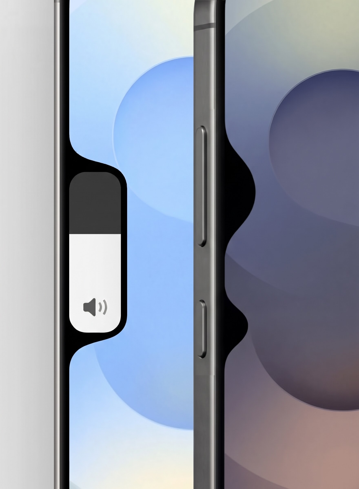

# Nudge

The app shows edge pops when you press the volume or power buttons and includes a volume slider based on a fan-made concept that has now become a reality.

## Features

- Edge pops on volume and power button presses
  
  Customize its width, height, Y-axis position, and timeout for each button
  
- Custom volume slider inspired by a fan-made design that was originally made for Iphones has now become a reality for Androids LOL.
  
  Customize its width, height, Y-axis position, timeout, with an option for floating. You can turn off the custom slider keeping only the edge pops!
  
- Choose which side you want to place the Edge pops and the custom slider
  
  Both can be in separate sides, with an option to change custom slider placement in landscape mode
  
- Both Edge pops and Custom slider can be turned off for landscape mode
- Want haptics too? there's an option for that
